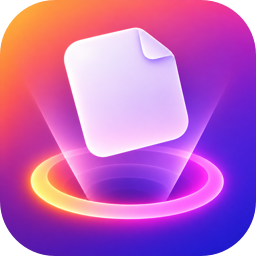

<p align="center">
  
  <h1 align="center">Dropshake</h1>
  <p align="center">A temporary shelf for files you want to move later.</p>
  <p align="center">
    <a href="https://github.com/exploringtruth/dropshake/releases/latest"></a>
    <a href="https://github.com/exploringtruth/dropshake/actions/workflows/release.yml"></a>
    <a href="LICENSE"></a>
    
  </p>
  <p align="center">
    <a href="https://github.com/exploringtruth/dropshake/releases/latest/download/Dropshake.dmg"><strong>Download the DMG</strong></a>
    &nbsp;·&nbsp;
    <a href="https://exploringtruth.github.io/dropshake/"><strong>Official website</strong></a>
  </p>
</p>

Dropshake is a free, open-source file shelf for macOS. Shake while dragging to set files aside, then move them into Finder or another app when you’re ready. Files stay in their original locations until you drag them out of the shelf.

Available for **macOS 13 and later**, on **Apple silicon and Intel Macs**.

## Install

Download the [latest DMG](https://github.com/exploringtruth/dropshake/releases/latest/download/Dropshake.dmg), open it, drag **Dropshake** into **Applications**, then eject the **Dropshake** disk in Finder. Or use the **Download the DMG** link above.

Packaged releases check for updates automatically and show an install prompt when a new version is available. Choose **Check for Updates** in the menu bar to check immediately.

### If macOS blocks Dropshake

Dropshake is currently not notarized by Apple. To approve it, follow these steps:

1. Open **Dropshake** once. When macOS shows the warning, click **Done**.
2. Open **System Settings → Privacy & Security**.
3. Scroll to **Security** and click **Open Anyway** next to the Dropshake warning.
4. Confirm **Open** in the dialog.
5. Look for the Dropshake icon in the menu bar to confirm the app is running.

You only need to approve the installed copy. macOS may ask again after you install a newly downloaded release. See [Apple’s instructions](https://support.apple.com/en-us/102445).

## Usage

1. Drag a file from Finder and shake your pointer while holding it. Dropshake opens a fresh shelf.
2. Drop the file onto the shelf. Add more files as you gather them; new arrivals are selected automatically.
3. Switch to the destination, then drag the selected file or files from the shelf into Finder or another app.

Inside the shelf:

- Press **⌘E** or choose **Open Shelf** from the menu bar to open an empty shelf manually.
- Search by file name or extension.
- Shift-click to select a range, or drag across blank shelf space to marquee-select items. Click blank space to clear the selection.
- Use **Add Clipboard Contents** in the menu bar to add clipboard items.
- The trash button removes selected items; with nothing selected, it clears the shelf.

## Features

- Shake while dragging a file to bring up a temporary shelf.
- Keep files in their original locations until you drag them to a destination.
- Search shelf contents by name or extension.
- Select and move multiple files together with Shift-click or marquee selection.
- Add clipboard contents from the menu bar.
- Move and resize the shelf window to fit your workflow.
- Get update checks and install prompts in packaged releases.

## Privacy

Shelf contents and preferences are stored locally on your Mac. Dropshake does not upload the files you place on the shelf. Packaged releases contact the GitHub-hosted update feed to check for new versions; downloading and installing an update happens through Sparkle when you choose to install it.

## FAQ

### Does adding a file to the shelf move it?

No. The shelf keeps a local reference to the file, which remains in its original location until you drag it to a destination.

### Does Dropshake work on Intel Macs?

Yes. The DMG contains a universal app for both Intel and Apple silicon Macs running macOS 13 or later.

### Why does macOS ask me to approve Dropshake?

Dropshake is not notarized by Apple yet. Follow the **If macOS blocks Dropshake** steps in the Install section once for the installed copy.

### How do I open the shelf without shaking a file?

Press **⌘E** or choose **Open Shelf** from the menu bar. This opens a fresh, empty shelf.

## Build from source

Requires Xcode and macOS.

```sh
swift run
```

To build the installer DMG:

```sh
bash ./scripts/build-dmg.sh
```

## Motivation

We wanted the handy temporary file-shelf workflow found in commercial Mac utilities such as Dropover to be available as a free, open-source app. Dropshake is an independent project and is not affiliated with Dropover.

## License

Dropshake is licensed under the GNU General Public License v3.0 or later ([GPL-3.0-or-later](LICENSE)).
