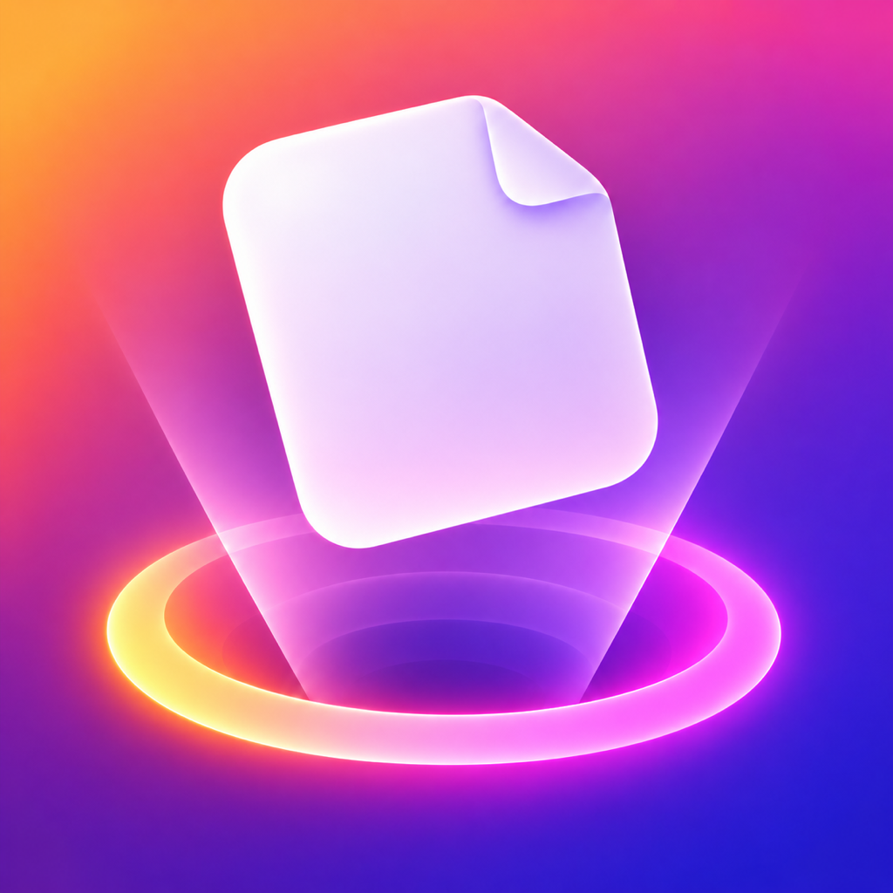

<p align="center">
  
  <h1 align="center">Dropshake</h1>
  <p align="center">A temporary shelf for files you want to move later.</p>
  <p align="center">
    <a href="https://github.com/exploringtruth/dropshake/releases/latest/download/Dropshake.dmg">
      
    </a>
  </p>
</p>

## Use Dropshake

1. Drag a file from Finder and shake your pointer to open a fresh shelf.
2. Drop the file onto the shelf while you switch to its destination.
3. Drag it from the shelf into Finder or another app. Select multiple items to move them together.

Use the menu bar icon to open the shelf or add files, links, and text from your clipboard.
Use **Check for Updates** to see whether a newer release is available, or **Get Latest Version** to install it.
Version 1.2.0 is the first release with in-app updates. Install it manually once; future releases can be installed from **Get Latest Version**.

## Install

Download the [latest DMG](https://github.com/exploringtruth/dropshake/releases/latest/download/Dropshake.dmg), open it, then drag **Dropshake** into **Applications**.

Requires macOS 13 or later. The app is currently ad-hoc signed, so macOS may ask you to confirm it the first time you open it.

### If macOS blocks Dropshake

Dropshake is currently not notarized by Apple. To approve it, follow these steps:

1. Open **Dropshake** once. When macOS shows the warning, click **Done**.
2. Open **System Settings → Privacy & Security**.
3. Scroll to **Security** and click **Open Anyway** next to the Dropshake warning.
4. Confirm **Open** in the dialog.
5. Look for the Dropshake icon in the menu bar to confirm the app is running.

You only need to approve the installed copy. macOS may ask again after you install a newly downloaded release. See [Apple’s instructions](https://support.apple.com/en-us/102445).

## Build from source

Requires Xcode and macOS.

```sh
swift run
```

To build the installer DMG:

```sh
bash ./scripts/build-dmg.sh
```

Dropshake is an independent project inspired by the file-shelf workflow. See [LICENSE](LICENSE).
